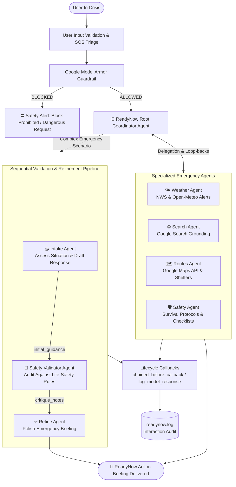

# 🚨 ReadyNow — Real-Time Disaster Response & Evacuation Assistant

A production-grade, multi-agent emergency response system built with **Google Agent Development Kit (ADK)** and deployed on **Google Cloud Vertex AI Agent Engine (Agent Platform)**.

ReadyNow helps people during disasters by answering three critical life-safety questions:
1. **What is going on?** — Real-time meteorological data, storm tracks, and active National Weather Service (NWS) hazard advisories, coupled with live Google Search for emergency declarations and road closures.
2. **Where to go?** — Turn-by-turn evacuation corridors, emergency travel time estimates (with congestion factor), and nearby designated shelters via the **Google Maps API**.
3. **How to stay safe?** — Authoritative disaster survival checklists (wildfire, flood, hurricane, tornado, earthquake, winter storm), home preparation, and emergency hotlines (911, FEMA, Red Cross).

Every response is governed by **Google Model Armor** guardrails, **multi-tier emergency input triage**, **lifecycle callback logging**, and an automated **sequential validation & refinement pipeline**.

---

## Table of Contents

- [Key Features](#key-features)
- [Architecture & Workflow](#architecture--workflow)
- [Specialized Agents](#specialized-agents)
- [Sequential Validation & Refinement Pipeline](#sequential-validation--refinement-pipeline)
- [Safety Guardrails & Input Validation](#safety-guardrails--input-validation)
- [Google Maps API Integration](#google-maps-api-integration)
- [Lifecycle Callbacks & Interaction Logging](#lifecycle-callbacks--interaction-logging)
- [Project Structure](#project-structure)
- [Installation & Setup](#installation--setup)
- [Running the Bot](#running-the-bot)
- [Running the Test Suite](#running-the-test-suite)
- [Deploying to Vertex AI Agent Platform](#deploying-to-vertex-ai-agent-platform)
- [Example Session](#example-session)

---

## Key Features

- **Root Coordinator Agent (`root_agent`)**: Greet users, describe capabilities, route inquiries to specialized sub-agents, and manage bidirectional transfers and loop-backs.
- **Weather Forecasting Agent (`weather_agent`)**: Real-time forecasts, temperatures, winds, and severe hazard alerts via NWS API with global Open-Meteo fallback.
- **Internet Search Agent (`search_agent`)**: Real-time web search for official emergency declarations, government press briefings, and road closures using Google ADK's `google_search`.
- **Evacuation Routes Agent (`routes_agent`)**: Driving routes, turn-by-turn guidance, emergency traffic factor (+50%), and shelter locator via **Google Maps API** (with resilient offline evacuation corridor fallback).
- **Disaster Q&A & Safety Agent (`safety_agent`)**: Life-saving survival checklists, utilities shutoff advice, go-bag checklists, and hotlines (911, FEMA: `1-800-621-3362`, Red Cross: `1-800-733-2767`, 211).
- **Sequential Refinement Workflow (`validation_refinement_pipeline`)**: 3-stage pipeline (Intake → Safety Validation & Critique → Refinement) ensuring life-safety compliance before final delivery.
- **Google Model Armor Guardrails**: Blocks dangerous weapons, explosives, malware, prompt injection, and emergency infrastructure sabotage.
- **Input Validation & Triage**: Detects critical SOS situations (e.g., trapped, active fire inside, rising floodwaters in attic) and immediately mandates 911 dispatch contact.
- **Callbacks & Persistent Audit Logging**: Logs all queries, tool invocations, model responses, and security alerts to `readynow.log`.
- **Cloud Deployment to Vertex AI Agent Engine**: Ready-to-run script (`deploy_to_vertex.py`) with pre-flight smoke tests, packaging into `AdkApp`, and remote session verification.

---

## Architecture & Workflow



---

## Specialized Agents

| Agent Name | Description | Key Tools Registered |
|------------|-------------|----------------------|
| `root_agent` | Orchestrates queries, explains capabilities, handles transfers and loop-backs | Sub-agents: `weather_agent`, `search_agent`, `routes_agent`, `safety_agent`, `validation_refinement_pipeline` |
| `weather_agent` | Real-time forecasts, temperatures, winds, hurricane advisories, flood warnings | `get_current_weather_and_hazards`, `get_weather_forecast`, `get_weather_alerts`, `get_lat_lon` |
| `search_agent` | Real-time web search for breaking disaster news and emergency declarations | `google_search` |
| `routes_agent` | Calculates evacuation corridors and finds emergency shelters | `get_evacuation_route`, `find_emergency_shelters`, `get_lat_lon` |
| `safety_agent` | Disaster checklists, home prep, utilities shutoff, emergency hotlines | `get_emergency_safety_checklist`, `get_emergency_contacts` |

---

## Sequential Validation & Refinement Pipeline

For multi-step disaster situations where users supply their location and situation, ReadyNow executes a **3-stage sequential workflow** implemented via ADK's `SequentialAgent`:

```
┌─────────────────┐       ┌────────────────────────┐       ┌────────────────────┐
│  intake_agent   │ ────► │ safety_validator_agent │ ────► │  refinement_agent  │
└─────────────────┘       └────────────────────────┘       └────────────────────┘
   Output state:                Output state:                    Output state:
 'initial_guidance'           'critique_notes'                  'final_answer'
```

1. **Intake Agent (`intake_agent`)**: Gathers live weather, routes, and checklists to produce an initial draft.
2. **Safety Validator Agent (`safety_validator_agent`)**: Audits the draft against non-negotiable life-safety criteria:
   - *Location Specificity*: Confirms target coordinates or named highways.
   - *Hierarchy of Urgency*: Verifies life-safety action (evacuate vs shelter-in-place) is placed first.
   - *Hazard Warnings*: Ensures explicit warnings against fatal traps (e.g. driving into floodwater, generator carbon monoxide in enclosed areas, downed wires).
   - *Route Delays*: Checks if evacuation traffic congestion factor (+50%) is stated.
   - *Emergency Contacts*: Confirms 911, FEMA (`1-800-621-3362`), and 211 are present.
3. **Refinement Agent (`refinement_agent`)**: Synthesizes the final briefing under the structured header `🚨 READYNOW EMERGENCY ACTION BRIEFING`.

---

## Safety Guardrails & Input Validation

### 1. Google Model Armor (`readynow/model_armor.py`)
- **Dangerous Content Filter**: Blocks queries seeking weapon/explosive assembly, chemical weapons, violence, or malware.
- **Prompt Injection Filter**: Blocks jailbreak attempts (DAN mode, ignoring system prompts, prompt extraction).
- **Infrastructure Sabotage Filter**: Blocks attempts to disrupt 911 dispatch, tamper with sirens, or loot shelters.
- **Permissive Safety**: Explicitly permits all legitimate emergency questions (first-aid, burn treatment, flood escape, gas shutoff).

### 2. Emergency Input Triage (`readynow/validator.py`)
- Detects **CRITICAL SOS** queries (e.g., *"trapped under rubble"*, *"rising water in attic"*, *"fire inside house"*).
- Pre-emptively displays high-visibility emergency dispatch guidance (`🚨 CALL 911 IMMEDIATELY`).
- Classifies queries into `CRITICAL_SOS`, `URGENT`, and `STANDARD`.

---

## Google Maps API Integration

ReadyNow provides evacuation routing via `readynow/tools.py`:
- **Live Google Maps API**: When `GOOGLE_MAPS_API_KEY` is present in `.env`, queries the Google Maps Directions API (`https://maps.googleapis.com/maps/api/directions/json`).
- **Disaster Traffic Multiplier**: Automatically factors emergency congestion delays (+50% travel time) into route summaries.
- **Resilient Fallback Mode**: When running offline or without an active Google Cloud billing account, an intelligent evacuation corridor simulator generates realistic distances, highway corridors, contraflow warnings, and designated shelter points so testing and demo modes never fail.

---

## Lifecycle Callbacks & Interaction Logging

ReadyNow implements Google ADK lifecycle hooks (`readynow/callbacks.py`):
- `chained_before_callback`:
  1. Screens with Model Armor guardrail (short-circuits on violation).
  2. Runs user input validation and priority triage.
  3. Logs approved prompts with session ID and priority level.
- `log_model_response`:
  1. Records model response text, timestamp, and responsible agent name.
- **Audit File**: All entries are persisted to [`readynow.log`](readynow.log).

---

## Project Structure

```
ReadyNow/
├── readynow/
│   ├── __init__.py           # Package exports & public API
│   ├── agents.py             # ADK Agent definitions (Root, Weather, Search, Routes, Safety, Refinement)
│   ├── callbacks.py          # ADK lifecycle hooks & ConversationLogger
│   ├── model_armor.py        # Model Armor prompt safety guardrail
│   ├── tools.py              # Weather tools, Google Maps evacuation routing, safety checklists
│   ├── validator.py          # Input sanity check & SOS priority triage
│   └── workflow.py           # Multi-agent architecture metadata & state helpers
├── deploy_to_vertex.py       # Deployment script for Vertex AI Agent Engine / Agent Platform
├── readynow_bot.py           # Interactive CLI application with live streaming & direct demo mode
├── test_readynow.py          # Comprehensive test suite (28 test cases)
├── requirements.txt          # Python dependencies
├── .env.example              # Environment variables template
├── .env                      # Local configuration file
└── README.md                 # Complete documentation
```

---

## Installation & Setup

### Prerequisites
- Python 3.10+ (tested on Python 3.10.8 with Google ADK 2.11.0)
- Google AI Studio API key (`GEMINI_API_KEY`)
- Optional: Google Maps API key (`GOOGLE_MAPS_API_KEY`)
- Optional: Google Cloud Project for Vertex AI Agent Platform deployment

### Step 1: Install Dependencies
```bash
py -3.10 -m pip install -r requirements.txt
```

### Step 2: Configure Environment
Copy `.env.example` to `.env` and fill in your keys:
```env
GEMINI_API_KEY=your_gemini_api_key_here
GEMINI_MODEL=gemini-2.5-flash
GOOGLE_MAPS_API_KEY=your_optional_maps_key
GOOGLE_CLOUD_PROJECT=your_gcp_project_id
GOOGLE_CLOUD_LOCATION=us-central1
GOOGLE_CLOUD_BUCKET=your_staging_bucket
```

---

## Running the Bot

### Interactive Multi-Agent CLI
Run the main CLI application:
```bash
py -3.10 readynow_bot.py
```

- If `GEMINI_API_KEY` is configured: Runs the full multi-agent pipeline with real-time token streaming and colored agent badges.
- If `GEMINI_API_KEY` is not yet set: Automatically launches in **Direct Tool Interactive Demo Mode**, enabling direct tool access (`weather <city>`, `route <from> to <to>`, `shelters <city>`, `checklist <disaster>`, `contacts`) while still enforcing Model Armor and logging to `readynow.log`.

---

## Running the Test Suite

Run the full suite of 28 unit and integration tests:

```bash
# Using pytest
py -3.10 -m pytest test_readynow.py -v

# Or using unittest
py -3.10 test_readynow.py
```

All 28 tests verify:
- ✅ Critical SOS detection and urgent triage classification
- ✅ Model Armor blocking of weapons, injections, and sabotage
- ✅ Permissive filtering for genuine disaster survival queries
- ✅ Live weather geocoding and NWS/Open-Meteo forecast retrieval
- ✅ Google Maps evacuation routing and emergency shelter lookups
- ✅ Survival checklists across all disaster types
- ✅ ConversationLogger file generation and event recording
- ✅ ADK Agent hierarchy, tool registration, and `InMemoryRunner` initialization

---

## Deploying to Vertex AI Agent Platform

To deploy ReadyNow to Google Cloud Vertex AI Agent Engine:

1. Authenticate with Google Cloud:
   ```bash
   gcloud auth application-default login
   ```
2. Verify `.env` has `GOOGLE_CLOUD_PROJECT`, `GOOGLE_CLOUD_LOCATION`, and `GOOGLE_CLOUD_BUCKET`.
3. Run the deployment script:
   ```bash
   py -3.10 deploy_to_vertex.py
   ```

The script will:
1. Validate cloud configuration.
2. Initialize the Vertex AI SDK.
3. Wrap `root_agent` inside `AdkApp(enable_tracing=True)`.
4. Run a local pre-flight smoke-test query.
5. Deploy via `vertexai.agent_engines.create(...)`.
6. Append the deployed resource name (`VERTEX_AGENT_RESOURCE`) to `.env`.
7. Initialize a remote session and run a verification query.

---

## Example Session

```
======================================================================
  🚨  ReadyNow  —  Real-Time Disaster Response & Evacuation Assistant
                 Powered by Google Agent Development Kit (ADK)
======================================================================
  Active Capabilities & Specialized Agents:
    • Root Coordinator        — Assesses situation, explains features & routes tasks
    • Weather Specialist      — Real-time forecasts, storm tracks & NWS hazard alerts
    • Google Search           — Breaking emergency declarations & road closures
    • Google Maps Routing     — Evacuation corridors, traffic delays & safe shelters
    • Safety & Survival       — Life-safety checklists (wildfire, flood, tornado, etc.)
    • Sequential Refinement   — 3-stage validation ensuring life-safety before delivery

❓ Emergency Situation or Inquiry: Hurricane approaching Tampa, FL. Where do I go and how do I stay safe?

  🚀  Coordinating response for session readynow_session_0001 …
  ──────────────────────────────────────────────────────────────────

  [🚨 Coordinator]  I am analyzing your situation. A hurricane warning is in effect for Tampa, FL.
  I am engaging our Weather Specialist, Google Maps Routing Agent, and Refinement Pipeline...

  [🌤️ Weather]  [Fetching current weather and hazard alerts for 'Tampa, FL'...]
  Location: Tampa, Hillsborough County, Florida
  Conditions: Heavy rain, wind gusts 65 mph, active Storm Surge Warning and Hurricane Watch.

  [🗺️ Routes (Google Maps)]  [Calculating Google Maps evacuation corridor: Tampa ➔ Orlando Safe Haven...]
  Corridor: I-4 Eastbound Inland Corridor
  Distance: 84 miles
  Evacuation Duration: Approx 2 hrs 30 mins (Factoring emergency congestion)
  Nearest Activated Shelter: Orlando Regional Convention Center Safe Haven

  [✨ Refine]
  🚨 READYNOW EMERGENCY ACTION BRIEFING
  ──────────────────────────────────────────────────────────────────
  📍 SITUATION & HAZARDS:
     A Hurricane Watch and Storm Surge Warning are active in Tampa, FL.
     Sustained winds 45 mph, gusts exceeding 65 mph. High risk of coastal inundation.

  🏃 WHERE TO GO (EVACUATION & SHELTER):
     • Primary Evacuation Corridor: Take I-4 East inland toward Orlando.
     • Distance & Travel Time: ~84 miles. Allow at least 2.5–3 hours due to evacuation traffic.
     • Nearest Red Cross Shelter: Orlando Regional Safe Haven (Dial 211 for open cot availability).

  🛡️ HOW TO STAY SAFE:
     1. Evacuate immediately if in Surge Zones A or B. Do NOT wait until winds exceed 45 mph.
     2. Pack your 3-day Go-Bag: prescriptions, photo IDs, phone chargers, and bottled water.
     3. Keep vehicle fuel above half-tank; keep headlights on and monitor NOAA Weather Radio.

  ⚠️ CRITICAL HAZARDS TO AVOID:
     • NEVER drive through standing or moving floodwater ("Turn Around, Don't Drown").
     • NEVER touch fallen wires—always assume utility lines are energized.
     • NEVER run portable gasoline generators indoors or in garages (deadly carbon monoxide).

  📞 EMERGENCY CONTACTS:
     • Immediate Life Threat: 911
     • FEMA Disaster Relief: 1-800-621-3362 (disasterassistance.gov)
     • American Red Cross: 1-800-733-2767
     • Local Shelter & Road Conditions: 211 / 511
```
